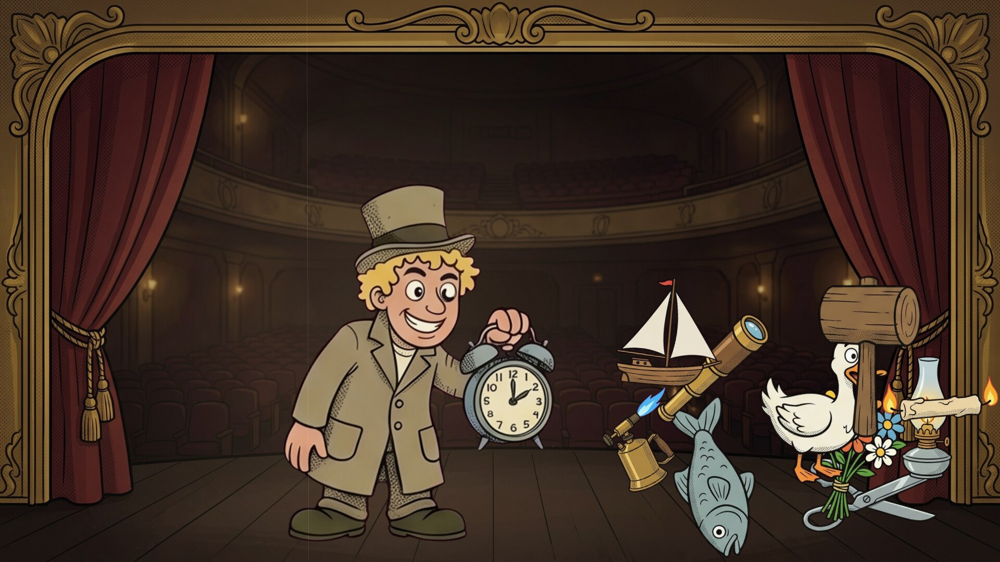
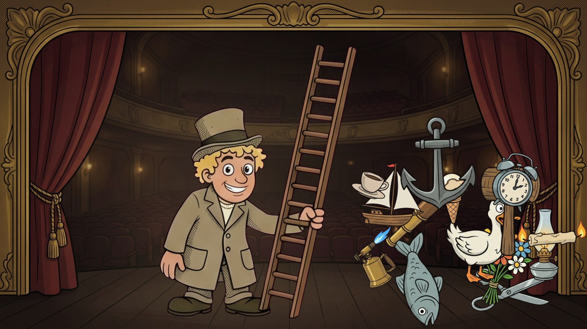
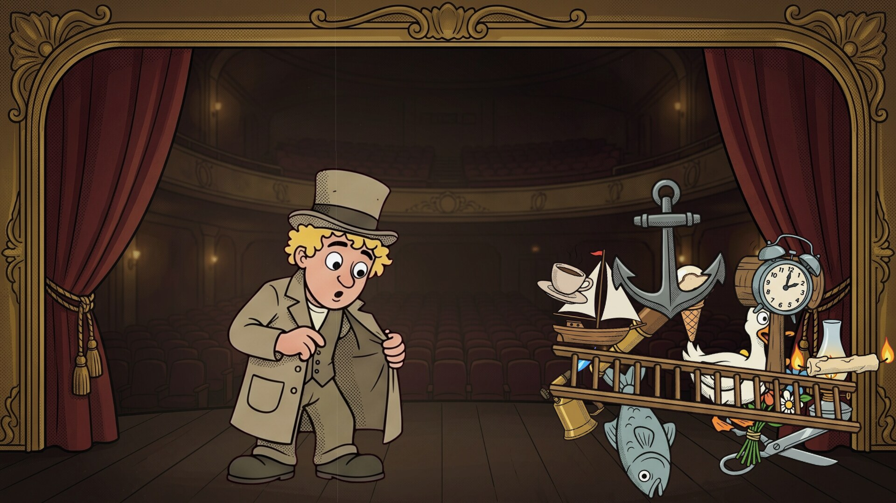

# Harpo's Coat

A cartoon screensaver: Harpo Marx on a vaudeville stage pulls one thing after another
out of his long coat. Runs on Linux, Windows and macOS. One of the
[Marx Brothers screensavers](https://github.com/mottipython/marx-screensavers).

## What it shows

Harpo reaches into his coat, pulls something out, holds it up to show us with a
grin, and tosses it over his shoulder onto a growing heap, where it bounces and
settles (the heavy things shake the whole heap). Then the next. Sixteen things in all, in a different order every time round: a
candle burning at both ends, a cup of hot coffee, a fish, a blowtorch, a mallet, a
live duck, a pair of enormous scissors, a ham sandwich, a telescope, an alarm clock
that goes off, an ice-cream cone, a toy sailboat, a bunch of flowers, an oil lamp,
an anchor, and last a ladder far too long for any coat, which he has to heave out
of it rung by rung. Then he looks into his coat, shrugs, the lights go down, and he
starts again. Between things he honks his horn, tips his hat or pulls his "gookie"
face.

With cartoon noises: the rustle of the coat, pops and swanee whistles, quacks, the
alarm bell, the blowtorch, and a thump, a clatter or a crash as each thing lands.

| | |
|---|---|
|  |  |
| An alarm clock | Honk |
|  |  |
| The ladder | The heap |

## Install

Packages are on the [releases page](../../releases).

### Windows

For Windows 10 or 11, step by step:

1. [**Download Harpo's Coat**](https://github.com/mottipython/harpos-coat/releases/latest/download/HarposCoat-Setup-1.0.0.exe).
2. If the browser says the file "isn't commonly downloaded" or "could harm your
   device", click the **⋯** (or **^**) beside it and choose **Keep**, then **Keep
   anyway**.
3. Open the downloaded file (click it at the top or bottom of the browser, or find
   it in the **Downloads** folder).
4. A blue box may say **"Windows protected your PC"**. Click **More info**, then
   **Run anyway**. (It says this because the program isn't signed with a paid
   certificate, not because anything is wrong with it.)
5. Windows asks **"Do you want to allow this app to make changes?"** Click **Yes**.
   (Windows only lists screen savers kept in its own system folder.)
6. Click **Next**, then **Install**, then **Finish**. The Screen Saver Settings open
   with "Harpo's Coat" already chosen. Click **OK**.

It comes on by itself when the computer has been left alone. To pick a different
one later, type **screen saver** in the Start menu search and open **Change screen
saver**. To remove it, open **Settings**, **Apps**, find it in the list and choose
**Uninstall**.

### macOS

For Apple Silicon and Intel, macOS 11 or later. Paste this into Terminal; it installs
the screen saver for your user and opens the Screen Saver settings:

    curl -fsSL https://raw.githubusercontent.com/mottipython/marx-screensavers/main/tools/mac-install.sh | sh -s -- harpos-coat

Or download the file ending `-mac-screensaver.zip` from the releases page, unzip it
and double-click the `.saver` file. It is not signed with an Apple developer
certificate, so macOS will refuse it at first: open System Settings, Privacy &
Security, and click Open Anyway.

### Linux

**Fedora, Nobara** (built on Fedora 44):

    sudo dnf install ./harpos-coat-1.0.0-1.fc44.x86_64.rpm

**Debian, Ubuntu, Mint** (Ubuntu 24.04 / Debian 13 or later):

    sudo apt install ./harpos-coat_1.0.0_amd64.deb

From your next login it starts by itself after five minutes idle on Wayland desktops
that provide ext-idle-notify (KDE Plasma, Sway, Hyprland, niri, COSMIC, labwc and
others), and any key or mouse movement ends it. `harpos-coat-screensaver` changes the
delay or turns it off. If
[screensaver-service](https://github.com/mottipython/screensaver-service) is
installed, it appears in its list instead.

## Sound on or off

The sound can be turned off and on from the screen saver settings: on Windows, the
**Settings…** button in Screen Saver Settings; on Linux, the **Settings** button in
[screensaver-service](https://github.com/mottipython/screensaver-service)'s list, or
`harpos-coat --settings`.

## Running it yourself

    harpos-coat              full screen on every display, with the sound
    harpos-coat --window     in a window; Esc or Q quits
    harpos-coat --mute       without the sound
    harpos-coat --settings   turn the sound on or off
    harpos-coat --snapshot out.bmp --time 55 --size 1920x1080

## How it was made

The cartoon pictures were drawn with Google's Gemini from the prompts in
`assets/PROMPTS.md` (the stage is the
[Groucho Clock](https://github.com/mottipython/groucho-clock)'s), then cut up by
`tools/make_parts.py` into the pictures in `assets/art` and animated in code. The program was written with Anthropic's
Claude, working from the author's direction. The noises are made in code, except
Harpo's horn and the duck, which are recordings: the horn from public-domain media,
and the duck from [Wikimedia Commons](https://commons.wikimedia.org/wiki/File:Anas_platyrhynchos_-_Mallard_XC112828.mp3)
(Jonathon Jongsma, CC BY-SA 3.0), as in [Duck Soup](https://github.com/mottipython/duck-soup).

## Building

Needs a C compiler, make and SDL2 (2.0.18 or newer). Build from the top of the source
tree, because the pictures and sounds in `assets/art` are built into the program.

    make

Packages are written to `dist/`, using the container in `tools/Containerfile`:

    podman build -t anathem-build -f tools/Containerfile tools
    podman run --rm --security-opt label=disable -v "$PWD":/src -w /src anathem-build make dist

## Credits and licence

The code is MIT. The duck recordings are CC BY-SA. An unofficial, non-commercial
homage, not connected with the Marx Brothers' estate or the studios. Images are
decoded with [stb_image](https://github.com/nothings/stb) and sound with stb_vorbis
(both public domain).
